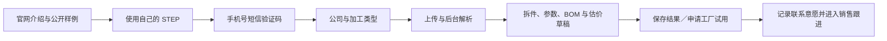

# 官网验证体验与销售线索一期方案

日期：2026-11-14。状态：先建设体验与线索流程，短信认证延后。下文的身份验证、稳定账户与角色分权为后续设计，不代表当前已实现。

## 本次实施范围

当前先采用“企业资料 → 上传 STEP → 拆件、参数与报价结果 → 申请工厂试用”的流程。企业名称、加工类型及手机号／微信号由用户填写，统一标为未验证；不发验证码、不创建已验证身份。销售联系意愿单独选择，默认不勾选，不影响体验。

沿用现有浏览器会话及订单归属、全站上传额度、真实 CAD 处理及报价。已保存订单仍可查看；新上传和再次处理先要求保存企业资料。体验阶段自动关联线索，申请试用可关联当前已保存结果，不重复解析模型。企业资料、申请、联系意愿与跟进记录保存于服务端私有 SQLite，不进入公开静态页或模型提示。

内部线索页 `/workbench/leads/` 和对应管理 API 沿用现有 Nginx 内部认证；列表脱敏，只有允许联系的资料在详情显示完整联系方式并记录查看。当前不是独立销售账号或权限体系。线上入口继续使用 `/try/`；用户清理浏览器 Cookie 后不会自动认领旧订单。

## 目标与范围

面向有意采购 AI 拆图、BOM 和报价系统的加工厂。官网提供通用体验，将已验证的账户、客户主动填写的企业信息、体验结果和销售联系意愿关联起来，供本公司销售跟进。

一期复用现有 STEP 解析、客户订单隔离、后台处理、模型预览及报价草稿。工厂材料价格、设备和工序规则通过独立配置接入。官网固定示例使用公开或自制资料，真实客户上传文件不进入公开案例、Git 或公共静态目录。

本方案不代替加工厂承接制造订单，也不根据填写的公司名称认定企业资质已认证。

## 体验流程

- 公开介绍和固定样例可浏览；上传自己的文件及使用私人体验功能前须完成验证。
- 当前方向采用手机号短信验证，优先评估阿里云号码认证服务（PNVS）中的短信认证服务；微信获客路径作为后续备选，不作为一期上线依赖。不得把输入微信号或点击“已关注”当作已验证。
- 资料补充控制在公司名称、加工类型两个项目；联系人姓名和岗位可后补。
- 体验结果沿用实际解析和明确估算，保留工程待核对状态，不把未验证工艺或演示费率包装成生产承诺。
- 申请工厂试用时可选择电话或企业微信沟通；后台将请求与本次模型、结果摘要和试用诉求关联。

## 验证与联系信息

手机号验证码证明当前用户控制该号码，不证明其是企业负责人。微信授权证明的是微信平台身份；openid／unionid 不等于用户可添加的微信号，也不能默认作为已授权销售联系的电话。

微信登录若作为独立入口，必须另有用户主动提供且可供联系的渠道，或接入公司企业微信客户联系流程。仅填写一个微信号不能标记为“已验证”。不同微信应用的主体标识须保留应用范围，不能用未验证的 unionid 字符串合并账户。

短信接入使用可替换的 provider：发送挑战、核验挑战、撤销挑战。首期建议使用阿里云 PNVS 的短信认证服务，采用平台预置签名与模板，并由平台生成、发送和核验验证码。普通 SMS 服务作为以后需要自定义品牌短信或通知短信时的可选适配，不混用两类产品的套餐包。

### 阿里云首期接入准备

- 阿里云账号完成实名认证，在号码认证控制台开通对应认证能力。
- 后端分别调用 `SendSmsVerifyCode` 和 `CheckSmsVerifyCode`；手机号、用途和挑战关联由我们的服务端控制。
- 一期仅接中国大陆手机号；采用平台自动生成验证码。自定义验证码不能假定可由同一核验接口代验。
- 发送和核验使用一致的认证方案配置；核验仅在 `Model.VerifyResult == "PASS"` 时成立，不能只根据 `Success=true` 授予登录或体验权限。
- 使用最小权限的服务端身份凭据；能使用云实例 RAM 角色时优先采用角色身份，不能把云主账号凭据放进前端。
- 阿里云凭据及正式配置只放服务器受保护配置中，不进入源码、聊天、模型调用或浏览器。
- 验证码调用走独立的阿里云服务适配器，不交给 Agent 发起，也不复用模型中转接口。
- 正式公司名称、官网域名、控制台开通情况及联系人告知内容仍需落实；真实短信配置就绪前不启用验证码验证或宣称身份已验证。当前的自报资料体验流程可独立发布。

选型依据（2026-11-14 查询）：阿里云官方指引提供预置签名模板，免单独申请企业资质、签名和模板，但阿里云账户仍需实名认证及开通服务。短信认证发送按量计费，核验免费；调试阶段可按量少量验证，不提前购买大套餐。计费以号码认证控制台为准，不能购买普通短信服务套餐来抵扣。

### 扫码路线的可行性与待确定项

| 路线 | 一期开发量判断 | 形成的关系 |
| --- | --- | --- |
| 微信扫码授权登录后发放账户体验额度 | 中等；需要对应应用权限、回调、网页绑定及幂等额度 | 微信平台身份；公众号关注独立且自愿，联系方式由用户另行提供 |
| 公众号带参数二维码＋关注／扫码事件 | 技术上中等；不采用强制关注或以额度奖励换关注的公开开通条件 | 用于自愿关注、来源识别与已授权的账号关联；不自动取得手机号 |
| 客户自愿咨询企业微信，销售确认后发试用邀请 | 较低；试用码需限时、一次兑换、绑定账户和额度 | 销售直接与客户建立联系；资格为人工确认，不冒充自动微信身份认证 |
| 企业微信客户添加回调关联试用线索 | 中等；依赖企业客户联系 API 权限、回调及身份绑定 | 关联联系人、来源、负责销售与体验事件；不得代替基础账户验证或用户联系意愿 |

普通固定公众号二维码不能可靠关联当前网页访客。自动开通需为网页请求创建随机、短期有效的场景标识；平台回调通过验签／解密后，服务端核对场景和用户，再由同一个事务绑定身份并发放额度。不能把手机号、公开订单编号或持久会话 token 放进二维码参数。已关注用户的扫码事件也应处理；重复扫码、取关再关注、刷新网页及回调重放不能重复领取。

已查到带参数二维码和事件推送可用于渠道及账号绑定的官方云产品文档。2026-11-14 通过微信官方规则页面公开读取的 JSON 正文核实：《微信公众平台运营规范》3.3.2 限制以利益或后续操作为条件的强制、诱导关注；3.22 另有限制强制关注的规定。因此公开方案采用扫码授权登录或手机号验证授予基础额度，公众号关注独立、自愿，不用“关注换体验次数”作为默认设计。扫码授权登录、自愿关注和添加企业微信不能混为同一验证方式。

推荐先确定公司现有微信开放平台应用／公众号／企业微信能力；销售通过用户自愿申请的企业微信咨询或获准联系方式跟进。手工发试用邀请可用于销售确认的试点客户，正式官网的验证与使用资格保持独立。

要求：

- 服务端核验后才授予权限，客户端传入的 `verified=true`、手机号或微信号无授权作用。
- 挑战绑定号码、用途和请求，设置失效时间、尝试上限、一次消费及发送冷却。
- 号码、IP、账户和平台维度限制发送与验证频率，独立设置短信费用预算。
- 验证服务不可用时拒绝开通；生产不允许固定验证码、测试 provider 或验证码回显。
- 验证成功轮换会话；注销、过期和撤销可使会话失效。
- 手机号、验证码及第三方访问凭据不进入 CAD 任务、模型提示、普通请求日志或公开报价。

## 账户与已有订单

现状：现有客户入口以随机 Cookie 的摘要作为匿名 owner，订单绑定该 owner；它尚不是经过手机号或微信验证的账户。

新增稳定的随机 `account_id`，把平台确认的身份与账户关联。客户会话引用账户授权的 owner 集合，不能按手机号、公司名或文件名查找并认领别人的订单。

旧浏览器会话升级需同时验证当前浏览器持有权和新账户身份，并显式确认历史绑定；已绑定给其他账户的 owner 不得重新关联。旧 token 不因绑定操作自动获得验证权限。跨账户切换清理前端结果缓存，历史报价保持不可变，账户关联单独记录。

验证模式必须在服务端覆盖全部公开别名：

- 原先的匿名 `/session` 仅能用于验证前流程，不能直接取得私人体验权限。
- 上传前先验证，拒绝未验证用户时不读取整份文件请求体。
- 上传、start、retry、工艺估算确认均须验证账户并核对额度和归属。
- 订单、制造清单、总装、单件、缩略图、STEP、DXF、报价与打印接口同样核对账户及归属。
- 公开样例与真实客户资料分开注册；操作员入口保留既有认证，销售角色不继承工程管理员全部权限。

现有全站 10 次上传账本与幂等恢复保证继续保留。新增账户额度绑定稳定账户，不能通过换浏览器、再次验证或切换登录方式刷新额度。公开推广前再确定正式账户配额及每日计算预算，不能直接重置已有账本。

## 线索与销售后台

最小数据结构：

| 记录 | 保存内容 |
| --- | --- |
| accounts | 随机账户编号、状态、创建时间 |
| verified_identities | 账户、验证渠道、限定范围的身份指纹、必要联系方式、验证时间 |
| sessions | 随机会话摘要、账户、失效时间、撤销状态 |
| leads | 账户、公司、加工类型、联系人补充信息、意向、负责人、跟进状态 |
| trial_events | 账户、任务／报价编号、来源渠道、体验阶段、必要结果摘要、时间 |
| consent_events | 用途、告知版本、选择、时间、撤回记录 |

同一验证身份重复使用时更新同一线索、追加体验事件；不同员工即使填写相同公司名，也不自动合并私人图纸或开通共享权限。

销售页面提供：

- 线索列表：公司、加工类型、验证渠道、最近体验、意向动作、负责人、跟进状态。
- 线索详情：经允许查看的联系方式、用户主动提供的需求和体验摘要。
- 跟进记录：待联系、已联系、试用中、方案／报价中、已成交、暂不打扰。
- 任务关联：保留来源编号与结果链接，权限验证通过后查看，不能生成公开图纸地址。
- 访问控制：列表默认脱敏，联系方式查看、导出、原始 CAD 查看／下载分别授权并记录访问。

一期先做本站受保护的线索后台。CRM、企业微信或其他系统的同步后续按明确字段和权限接入，不把完整客户图纸默认复制到销售工具。

## 联系意愿与数据用途

登录验证用于账户识别和体验资源管理；销售联系意愿单独记录，不默认勾选。用户拒绝销售联系时仍可使用已获授权的体验，联系意愿撤回后停止新的销售跟进。

建议提示语：

> 我愿意由［公司名称］的顾问通过我提供的联系方式，联系我了解 AI 拆图与报价系统。可随时取消。

上线前填写实际公司名称、联系方式、数据用途及保存期限，提供便捷的查询、更正、删除和撤回渠道。联系方式按最小必要范围保存；到期删除或匿名化。销售待跟进列表只包含当前允许联系的线索。

## 开发与上线顺序

1. 建立账户、验证 provider 接口、线索与联系意愿存储。
2. 接入真实验证码服务，完成验证页、简短资料页和服务端权限检查。
3. 关联现有解析任务与结果，完成受保护的销售线索页面。
4. 在服务器验证未登录绕过、验证码重放、发送滥用、跨账户访问、会话切换、旧会话升级、额度恢复及撤回联系意愿。
5. 使用正式域名、实际公司告知和生产配置完成验收后，再启用官网验证入口。

真实验证服务未配置时，不启用生产验证流程。测试 provider 只用于服务器隔离测试环境，不能用于官网获客。全部测试、构建、CAD 计算和浏览器验收在远程服务器的资源受限单元执行，继续保留现有内存及几何并发保护。

## 已查阅的官方资料

- [阿里云短信服务与短信认证服务选型指南](https://help.aliyun.com/zh/sms/product-overview/selection-guide-for-short-message-service-and-sms-verification-service)：两类产品的接口、模板和验证码托管差异；最终开通条件以企业控制台为准。
- [阿里云短信认证服务新手指引](https://help.aliyun.com/zh/pnvs/getting-started/sms-authentication-service-novice-guide)：实名认证、服务开通、预置签名模板和验证码发送／核验流程。
- [发送验证码接口](https://help.aliyun.com/zh/pnvs/developer-reference/api-dypnsapi-2017-05-25-sendsmsverifycode)、[核验验证码接口](https://help.aliyun.com/zh/pnvs/developer-reference/api-dypnsapi-2017-05-25-checksmsverifycode)：方案配置、自动生成与核验结果的判定要求。
- [阿里云号码认证服务产品计费](https://help.aliyun.com/zh/pnvs/product-overview/product-pricing)：短信认证 API 计费及与其他套餐的区别。
- [腾讯云微信授权登录](https://cloud.tencent.com/document/product/1441/68675)：微信授权 code 与 openid／unionid 身份关联，及不同应用的授权要求。
- [阿里云微信公众号二维码](https://help.aliyun.com/zh/document_detail/2928316.html)：带参数二维码的事件推送、账号绑定、扫码回复和来源信息，不能据此认定某类获客活动已获微信平台许可。
- [微信公众平台运营规范](https://mp.weixin.qq.com/publicpoc/opshowpage?action=newoplaw)：本次通过页面公开读取的 [官方 JSON 正文](https://mp.weixin.qq.com/publicpoc/opshowpage?action=newoplaw&f=json) 核对 3.3.2 和 3.22，采用与关注独立的账户验证流程。
- [中华人民共和国个人信息保护法](https://www.samr.gov.cn/zw/zfxxgk/fdzdgknr/bgt/art/2023/art_f374e8245320413181742e6d1baf4366.html)：第十四至十七条的同意、撤回及告知要求，第十九条的必要保存期限。
